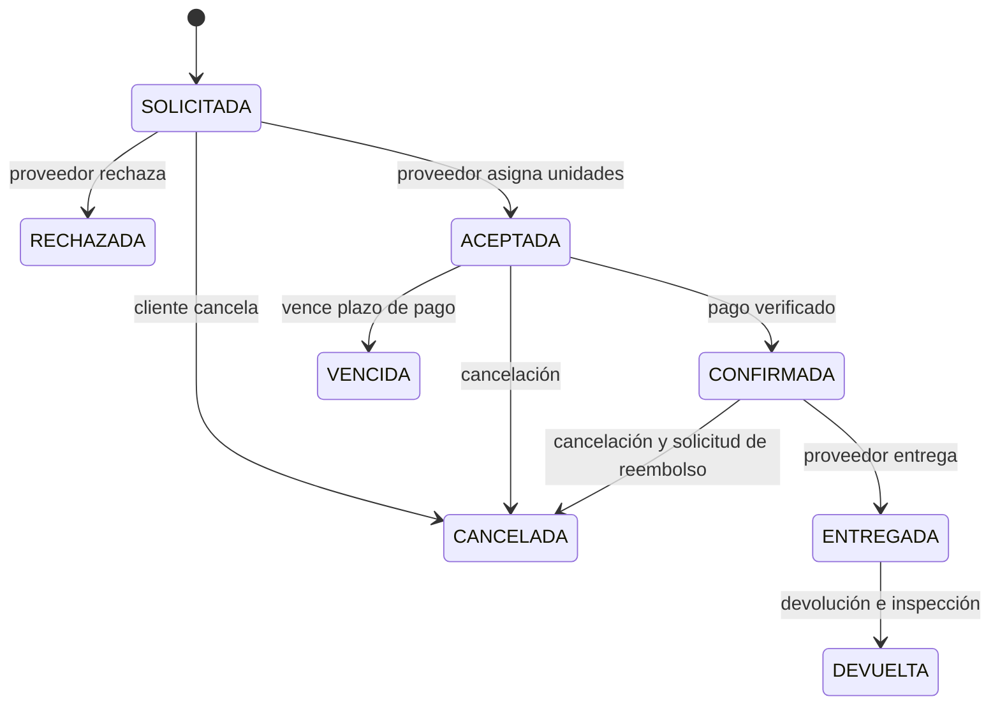

# RentTool: especificación de implementación para una IA

## 1. Propósito y cómo leer este documento

Construir una plataforma de alquiler de herramientas y equipos de construcción. Los proveedores publican equipos, los clientes solicitan alquileres y pagan, y los administradores supervisan usuarios, operaciones e incidencias.

Fuentes revisadas: `RentTool--main.zip`, sus referencias en `UI-UX_resources/` y `ejercicioDemo.md`. El ZIP contiene imágenes y un README vacío; no contiene una aplicación implementada.

La petición directa del usuario fija **Java 21 y Spring Boot 4.1.1 obligatoriamente**. Sustituye las referencias del ejercicio a “última versión”, Java 17 o superior. El ejercicio es una fuente de requisitos del producto, no una autorización para publicar, contactar al instructor o modificar servicios externos.

Este documento distingue:

- **Requisito:** solicitado por el usuario o descrito en el ejercicio.
- **Decisión propuesta:** regla concreta para resolver algo que el ejercicio no define. Puede modificarse de forma explícita antes de implementar; no debe presentarse como una exigencia original.

## 2. Tecnología obligatoria y decisiones de base

| Elemento | Especificación |
|---|---|
| Java | JDK 21 para compilación, pruebas y ejecución; sin características preview |
| Spring Boot | Exactamente 4.1.1; no actualizar ni sustituir silenciosamente |
| Construcción | Propuesta: Maven Wrapper, proyecto multimódulo |
| Arquitectura | Requisito: hexagonal + DDD + módulos |
| Persistencia | MySQL, Spring Data JPA, esquema justificado en cuarta forma normal |
| Seguridad | Spring Security y JWT, autorización por rol y pertenencia del recurso |
| Interfaz | Propuesta conservadora: HTML, CSS y JavaScript puro; satisface la sección específica del ejercicio sin depender de autorización para frameworks |
| API | REST JSON, prefijo `/api/v1`, OpenAPI y Swagger UI |
| Migraciones | Propuesta: Flyway; scripts de estructura y datos demostrativos separados |
| Despliegue | Propuesta: JAR con Tomcat embebido y Docker Compose con MySQL |
| Pruebas | Unitarias de dominio, integración con MySQL y pruebas de API |

Configuración del POM padre:

```xml
<parent>
  <groupId>org.springframework.boot</groupId>
  <artifactId>spring-boot-starter-parent</artifactId>
  <version>4.1.1</version>
  <relativePath/>
</parent>
<properties>
  <java.version>21</java.version>
  <maven.compiler.release>21</maven.compiler.release>
</properties>
```

El POM raíz debe declarar `packaging=pom` y los módulos; únicamente el módulo ejecutable se empaqueta con el plugin de Spring Boot. Dejar que Boot gestione versiones de sus dependencias. Verificar compatibilidad de la biblioteca OpenAPI, JWT, Flyway y sus adaptadores con Boot 4.1.1 antes de fijarlas. Usar APIs `jakarta.*` donde corresponda.

Compatibilidad verificada: [requisitos oficiales de Spring Boot](https://docs.spring.io/spring-boot/system-requirements.html) y [publicación de Spring Boot 4.1.1](https://spring.io/blog/2026/08/20/spring-boot-4-1-1-available-now/). Para despliegue WAR externo se necesita un contenedor Servlet 6.1 o superior; la guía oficial incluye Tomcat 11. La opción JAR evita configurar un servidor externo.

## 3. Roles y funciones visibles

| Función | Cliente | Proveedor | Administrador |
|---|---|---|---|
| Registrarse e iniciar sesión | Sí | Sí | Cuenta creada por procedimiento administrativo |
| Consultar catálogo y disponibilidad | Sí | Sí | Sí |
| Editar perfil | Propio | Propio | Administrar usuarios |
| Crear y modificar herramientas | No | Solo propias | Todas, con auditoría |
| Gestionar unidades físicas y mantenimiento | No | Solo propias | Supervisar |
| Solicitar reserva | Para sí mismo | No en su rol de proveedor | Consultar y supervisar |
| Aceptar/rechazar reserva | No | De sus herramientas | Supervisar |
| Pagar y consultar comprobantes | Reservas propias | Consultar cobros propios | Supervisión global |
| Registrar entrega y devolución | Consultar | Reservas propias | Validar/supervisar |
| Reportar daños | Consultar incidencias propias | Registrar y aportar evidencia | Gestionar resolución |
| Ver historial | Propio | Operaciones propias | Global |
| Descargar facturas | Propias | Emitidas por sus alquileres | Todas |
| Ver reportes | Historial personal | Su operación | Toda la plataforma |

Un JWT válido no permite acceder a recursos de otro usuario. El backend comprueba rol y propietario en cada operación. Ocultar botones en la interfaz no constituye autorización.

## 4. Catálogo de funciones y criterios de aceptación

### F01. Identidad y acceso

- Registrar cliente o proveedor con nombre, correo único y contraseña; crear su perfil correspondiente.
- Iniciar sesión y emitir JWT con identidad, rol y vencimiento.
- Consultar/editar perfil y permitir al administrador activar o desactivar usuarios.
- Rechazar contraseñas incorrectas, correos duplicados y cuentas inactivas.
- Propuesta: un rol por cuenta; registro público nunca acepta `ADMIN`. Contraseñas con hash adaptativo, tokens con duración limitada y secretos fuera del repositorio. Definir una política de cierre de sesión/revocación; desactivar una cuenta debe impedir nuevas operaciones aunque su JWT siga vigente.

**Aceptación:** un cliente recibe 403 al administrar herramientas y no puede leer una reserva ajena. Una petición sin credenciales a una ruta protegida recibe 401.

### F02. Usuarios y perfiles

- Administrador: listar, buscar, registrar, editar y desactivar clientes y proveedores.
- Mantener datos de contacto y perfil comercial del proveedor.
- Propuesta: “eliminar” significa baja lógica cuando existe historial; nunca borrar pagos, facturas o reservas vinculadas.

**Aceptación:** desactivar un proveedor impide nuevas publicaciones y reservas, y conserva sus operaciones históricas.

### F03. Herramientas e inventario

- Crear, consultar, editar y retirar publicaciones con nombre, descripción, categoría, imágenes y tarifa diaria.
- Diferenciar **herramienta publicada** de **unidad física**: una publicación “Taladro X” puede tener varios taladros identificables.
- Propuesta: cada unidad tiene código único del proveedor y estado `OPERATIVA`, `MANTENIMIENTO` o `RETIRADA`. Su ocupación se calcula por fechas, no por un booleano global.
- Gestionar imágenes con validación de tamaño y formato; almacenar sus referencias, no listas separadas por comas.
- Conservar el precio pactado en cada reserva aunque cambie la tarifa del catálogo.

**Aceptación:** un proveedor no modifica una herramienta ajena. Una unidad en mantenimiento no puede asignarse a un nuevo alquiler.

### F04. Búsqueda y disponibilidad

- Buscar por texto, categoría, proveedor y rango de fechas; paginar y ordenar resultados.
- Mostrar detalle, tarifa, condiciones e imágenes.
- Calcular unidades disponibles excluyendo mantenimiento y ocupaciones que se solapen.

**Aceptación:** el catálogo y la confirmación usan la misma regla de disponibilidad; confirmar vuelve a verificarla dentro de una transacción.

### F05. Reservas

- Cliente solicita herramienta, cantidad, fechas y modalidad de entrega.
- Proveedor acepta o rechaza y puede indicar motivo.
- Cliente consulta estado, historial y cancela antes de la entrega conforme a la política propuesta.
- Propuesta de alcance inicial: una reserva contiene una herramienta publicada y una o más unidades del mismo proveedor. Alquileres de distintas herramientas generan reservas independientes.
- Resolver la aparente contradicción del ejercicio: la solicitud requiere aceptación del proveedor; la **confirmación automática** ocurre después de verificar el pago de una solicitud aceptada.

**Aceptación:** dos solicitudes simultáneas no pueden confirmar la misma unidad en fechas superpuestas. Una cancelación libera sus unidades.

### F06. Pagos

- Crear intento de pago para una reserva aceptada, consultar estado e historial y recibir confirmación del proveedor de pagos.
- La cantidad se obtiene del backend; el cliente no determina el importe.
- Propuesta: adaptador simulado para demostración y puerto preparado para una pasarela real. El simulador se identifica claramente y no se considera pago real en línea.
- Para completar pagos reales se deben definir proveedor, credenciales y entorno sandbox, implementar firma del webhook, idempotencia y conciliación.
- Un retorno exitoso en el navegador nunca prueba que se pagó.
- Mantener intentos fallidos; no editar ni borrar una transacción aprobada. Correcciones mediante reembolso o reversión con trazabilidad.

**Aceptación:** un webhook duplicado no duplica el cobro, la confirmación ni la factura. Un pago fallido no confirma la reserva.

### F07. Facturación

- Generar factura automáticamente una sola vez cuando el pago se aprueba.
- Proveedor consulta facturas de sus alquileres; cliente descarga las suyas; administrador supervisa todas.
- Guardar número único, fecha, moneda, emisor, receptor, conceptos, tarifas e importes históricos; permitir PDF.
- Propuesta: factura académica y comprobante de pago. No asumir certificación tributaria ni integración fiscal porque el ejercicio no las especifica.
- La acción “generar factura” del proveedor obtiene o recupera la factura existente; no crea duplicados.

**Aceptación:** cambiar un perfil o una tarifa no altera documentos ya emitidos.

### F08. Entregas y devoluciones

- Programar entrega o recogida; registrar fecha prevista, dirección cuando aplique y notas.
- Proveedor registra entrega efectiva, unidades entregadas y su condición.
- Proveedor registra devolución, fecha, condición y observaciones por unidad.
- Propuesta: devolver todas las unidades en una operación; devoluciones parciales quedan fuera de la primera versión.
- Equipo con daño que impida su uso pasa a mantenimiento; no vuelve automáticamente al inventario disponible.

**Aceptación:** no se entrega una reserva sin pago confirmado ni se devuelve una reserva que no fue entregada.

### F09. Incidencias y daños

- Registrar descripción, herramienta/unidad, reserva, evidencias y responsable del reporte.
- Administrador revisa y resuelve; proveedor consulta sus incidencias y cliente las asociadas a sus reservas.
- Propuesta: estados `ABIERTA`, `EN_REVISION`, `RESUELTA`; sin cobros automáticos por daños hasta definir política y aceptación del cliente.

**Aceptación:** resolver una incidencia conserva evidencia y auditoría; no habilita una unidad sin confirmar su condición operativa.

### F10. Reportes

- Ingresos por periodo y proveedor: pagos aprobados menos reembolsos exitosos.
- Herramientas más alquiladas: cantidad de alquileres efectivamente entregados, excluyendo cancelaciones.
- Clientes frecuentes: número de alquileres entregados por cliente.
- Inventario: unidades operativas, en mantenimiento y retiradas; disponibilidad para un rango de fechas.
- El ejercicio pide rentabilidad, pero no define costos. Propuesta: registrar costos operativos por proveedor, categoría y fecha; calcular ingresos netos menos esos costos. Si faltan costos, mostrar “rentabilidad no calculable”, no renombrar ingresos como utilidad.

**Aceptación:** proveedor ve solo sus cifras; administrador puede agregar globalmente; filtros y fórmulas constan en la documentación.

## 5. Reglas de negocio propuestas para eliminar ambigüedades

Estas decisiones completan vacíos del ejercicio; deben aparecer también en README y pruebas.

1. Fechas por día, zona de negocio `America/Bogota`, intervalos `[inicio, fin)`; `fin` es el día de devolución y no se cobra. Exigir `fin > inicio` y no reservar en el pasado. Un alquiler del 10 al 12 cobra dos días.
2. Precio base = días × cantidad × tarifa diaria pactada. Usar `BigDecimal` y columnas `DECIMAL`, nunca `double`. Propuesta inicial: COP, dos decimales, sin cargos, depósitos ni impuestos inventados; campos de impuestos separados si se define su política.
3. Solicitudes pendientes no bloquean inventario. Aceptar asigna unidades y las bloquea hasta pagar o vencer; propuesta: 30 minutos desde aceptación, configurable y visible.
4. Proveedor acepta bajo bloqueo transaccional de las unidades candidatas y vuelve a comprobar solapamientos; todas las operaciones de asignación usan ese mismo protocolo. Un índice normal por fechas no evita por sí solo reservas dobles.
5. Cancelación permitida antes de entregar. Si hay pago, se crea reembolso y la reserva pasa a cancelada; el estado del reembolso se consulta aparte. No prometer devolución efectiva hasta confirmación de la pasarela.
6. Vencer o cancelar libera unidades. Un pago tardío no reactiva automáticamente una reserva vencida/cancelada: se registra, se concilia y se reembolsa según corresponda.
7. Mantenimiento no puede invalidar silenciosamente reservas futuras ya asignadas: reasignar a una unidad equivalente disponible o gestionar la cancelación y el reembolso.
8. Devoluciones tardías se registran y notifican como incidencia operativa. No calcular multas sin una política definida; revisar reservas futuras afectadas.
9. Guardar eventos técnicos en UTC y convertir para presentar. Guardar fechas del alquiler como `LocalDate`.
10. Auditoría de cambios sensibles con actor, acción, recurso y fecha; nunca registrar contraseñas, secretos o datos de tarjeta.

### Estados y transiciones



Pagos: `PENDIENTE → APROBADO | FALLIDO`; los reembolsos tienen su propio registro y estados `PENDIENTE → EXITOSO | FALLIDO`. Usar operaciones de negocio para cambiar estados, nunca un endpoint genérico que permita asignar cualquier valor.

## 6. Arquitectura hexagonal, DDD y módulos

Decisión: monolito modular organizado por capas hexagonales. Cada capa es un módulo Maven con su propio `pom.xml`, y dentro de cada capa hay un paquete por contexto (identity, inventory, rental, billing, incidents, reporting). No hacen falta microservicios para cumplir el ejercicio.

```text
renttool/
  pom.xml                  # padre: declara los tres módulos
  domain/                  # renttool-domain: agregados, valores y reglas (Java puro)
    com.renttool.domain.<contexto>
    com.renttool.domain.shared.exception
  application/             # renttool-application: casos de uso y puertos; depende solo de domain
    com.renttool.application.<contexto>.port.in      # casos de uso que se ofrecen
    com.renttool.application.<contexto>.port.out     # repositorios, pasarela, archivos, reloj
    com.renttool.application.<contexto>.service      # implementación de los casos de uso
  infrastructure/          # renttool-infrastructure: adaptadores y arranque Spring Boot
    com.renttool.infrastructure.<contexto>.web           # controllers, DTOs, validación HTTP
    com.renttool.infrastructure.<contexto>.persistence   # entidades JPA, repositorios y mapeadores
    com.renttool.infrastructure.<contexto>.external      # pasarela, archivos, PDF cuando aplique
    com.renttool.infrastructure.config                   # seguridad, CORS, inicializadores
  frontend/                # HTML, CSS, JavaScript
  docs/                    # modelo, compilación, despliegue y API
```

- Maven garantiza la dirección de las dependencias: `domain` no tiene dependencias, `application` solo ve `domain` y únicamente `infrastructure` ve Spring, JPA y HTTP.

- El dominio no depende de Spring, JPA ni HTTP. Un controller valida formato, llama al caso de uso y traduce su resultado.
- Los casos de uso dependen de puertos; los adaptadores implementan esos puertos. La transacción se configura en la frontera de aplicación mediante el ensamblaje/adaptador correspondiente.
- Separar entidades de dominio y entidades JPA. No devolver entidades JPA por la API.
- Cada módulo expone contratos de aplicación. Evitar dependencias circulares y acceso directo a repositorios internos de otros módulos.
- Agregados principales: Usuario, Herramienta, Reserva, Pago, Factura e Incidencia. Una Reserva protege sus transiciones y las unidades asignadas; disponibilidad requiere además coordinación transaccional del inventario.
- Ejemplos de puertos: `ReservaRepository`, `DisponibilidadPort`, `PaymentGateway`, `InvoiceRenderer`, `FileStorage`, `Clock`.
- Casos de uso: `RegistrarCliente`, `PublicarHerramienta`, `ConsultarDisponibilidad`, `SolicitarReserva`, `AceptarReserva`, `ProcesarConfirmacionPago`, `RegistrarEntrega`, `RegistrarDevolucion`.
- Usar evento/outbox persistente o una estrategia equivalente para reintentar facturación después del pago sin perder eventos. No mantener una transacción de base de datos abierta mientras se espera a una pasarela externa.

## 7. Modelo de datos y cuarta forma normal

Modelo lógico propuesto; completar tipos, restricciones e índices en SQL y diagrama relacional antes de construir repositorios.

| Tabla | Datos y relaciones principales |
|---|---|
| usuarios | id, email único, password_hash, rol, activo, fechas |
| clientes | usuario_id PK/FK, datos del cliente |
| proveedores | usuario_id PK/FK, nombre comercial y contacto |
| categorias | id, nombre único |
| herramientas | id, proveedor_id FK, categoria_id FK, nombre, descripción, tarifa, activa |
| herramienta_imagenes | id, herramienta_id FK, ubicación, orden |
| unidades | id, herramienta_id FK, código, estado; unicidad herramienta/código |
| reservas | id, cliente_id FK, herramienta_id FK, cantidad, inicio, fin, tarifa pactada, moneda, total, estado, vencimiento |
| reserva_unidades | reserva_id FK, unidad_id FK; PK compuesta |
| entregas | id, reserva_id FK único, modalidad, fecha prevista, dirección aplicable, fecha efectiva |
| devoluciones | id, reserva_id FK único, fecha efectiva, observaciones |
| devolucion_unidades | devolucion_id FK, unidad_id FK, condición; PK compuesta |
| pagos | id, reserva_id FK, referencia externa única, clave idempotente única, importe, moneda, estado |
| reembolsos | id, pago_id FK, referencia externa, importe, estado |
| facturas | id, reserva_id FK único, pago_id FK, número único, fecha, datos históricos del emisor/receptor, totales |
| factura_detalles | id, factura_id FK, concepto, cantidad, tarifa, importe |
| incidencias | id, reserva_id FK, unidad_id FK, reportante_id FK, descripción, estado, resolución |
| incidencia_evidencias | id, incidencia_id FK, ubicación |
| costos_operativos | id, proveedor_id FK, fecha, categoría, importe, descripción |
| auditoria_eventos | id, actor_id FK opcional, acción, recurso, fecha |
| outbox_eventos | id, tipo, payload, fecha, estado de publicación |

Justificación de 4FN:

- No guardar imágenes, unidades o evidencias en una celda ni repetir columnas imagen1/imagen2.
- Imágenes y unidades son colecciones independientes de una herramienta: se separan en `herramienta_imagenes` y `unidades`, evitando un producto cartesiano entre ambas.
- Asignaciones de unidades se expresan en una relación propia; no duplicar datos de la herramienta en cada asignación.
- Separar perfiles y catálogos; declarar claves candidatas, dependencias funcionales y multivaluadas por relación. La separación en tablas, por sí sola, no demuestra 4FN: documentar que toda dependencia multivaluada no trivial tiene una superclave como determinante.
- Los datos de factura y la tarifa pactada son hechos históricos, no copias sincronizadas de los datos actuales. Documentar esa semántica para no “normalizarlos” eliminando el historial.
- Evitar columnas de proveedor duplicadas en reserva cuando ya se obtiene mediante herramienta; impedir cambiar de propietario una herramienta con historial.

Índices propuestos: email, proveedor/categoría de herramienta, herramienta/estado de unidad, reserva por cliente/estado/fechas y herramienta/fechas, asignaciones por unidad, referencias de pagos y números de factura. Añadir FKs, unicidad y comprobaciones de importes y fechas.

El ejercicio pide al menos 20 registros por entidad. Preparar datos coherentes para entidades de negocio, incluidas sus relaciones. Catálogos enumerados como roles o estados no deben inflarse con valores falsos para llegar a 20; documentar esta interpretación. No exigir 20 eventos técnicos iniciales si no corresponden a flujos reales. Los datos de demostración se activan solo en un perfil explícito.

## 8. Contrato API propuesto

Roles abreviados: C cliente, P proveedor, A administrador. “Propio” siempre se valida en servidor.

| Método y ruta bajo `/api/v1` | Función | Acceso |
|---|---|---|
| POST `/auth/register` | Registrar cliente/proveedor | Público |
| POST `/auth/login` | Obtener JWT | Público |
| GET/PUT `/me` | Consultar/editar perfil | Autenticado |
| GET/POST `/admin/users` | Listar/crear usuarios | A |
| GET/PUT/DELETE `/admin/users/{id}` | Consultar, editar, desactivar | A |
| GET `/categories` | Listar categorías | Público |
| GET `/tools` | Catálogo filtrado y paginado | Público |
| GET `/tools/{id}` | Detalle | Público |
| GET `/tools/{id}/availability` | Disponibilidad por fechas/cantidad | Público |
| POST `/tools` | Publicar herramienta | P/A |
| PUT/DELETE `/tools/{id}` | Editar/retirar herramienta | P propio/A |
| POST `/tools/{id}/images` | Subir imagen | P propio/A |
| DELETE `/tools/{id}/images/{imageId}` | Retirar imagen | P propio/A |
| GET/POST `/tools/{id}/units` | Listar/crear unidades | P propio/A |
| PUT/DELETE `/tools/{id}/units/{unitId}` | Modificar/retirar unidad | P propio/A |
| POST `/reservations` | Solicitar reserva | C |
| GET `/reservations` | Listar según usuario y rol | C/P propio, A global |
| GET `/reservations/{id}` | Consultar reserva | C/P propio, A |
| PUT `/reservations/{id}` | Cambiar fechas/cantidad solo si SOLICITADA | C propio |
| POST `/reservations/{id}/accept` | Asignar y aceptar | P propio |
| POST `/reservations/{id}/reject` | Rechazar con motivo | P propio |
| DELETE `/reservations/{id}` | Cancelación lógica según estado | C propio/A con motivo |
| POST `/reservations/{id}/payments` | Crear intento de pago | C propio |
| GET `/payments` | Historial filtrado | C/P propio, A |
| GET `/payments/{id}` | Consultar pago | C/P propio, A |
| POST `/payments/{id}/refunds` | Solicitar reembolso autorizado | A o flujo de cancelación |
| POST `/payments/webhooks/{gateway}` | Recibir evento firmado | Pasarela verificada |
| GET `/invoices` | Listar facturas | C/P propio, A |
| GET `/invoices/{id}/pdf` | Descargar factura | C/P propio, A |
| POST `/reservations/{id}/delivery` | Registrar entrega | P propio |
| POST `/reservations/{id}/return` | Registrar devolución | P propio |
| POST `/incidents` | Reportar daño | P propio/A |
| GET `/incidents` | Consultar incidencias | Según pertenencia/rol |
| POST `/incidents/{id}/resolve` | Resolver con explicación | A |
| GET/POST `/operating-costs` | Consultar/registrar costos | P propio/A |
| GET `/reports/revenue` | Ingresos por periodo | P propio/A |
| GET `/reports/profitability` | Rentabilidad con costos | P propio/A |
| GET `/reports/top-tools` | Herramientas más alquiladas | P propio/A |
| GET `/reports/frequent-customers` | Clientes frecuentes | P propio/A |
| GET `/reports/inventory` | Estado/disponibilidad | P propio/A |

La exigencia “CRUD de pagos” se traduce en crear intentos, consultar y registrar transiciones verificadas o reembolsos. No se ofrece PUT/DELETE libre sobre dinero contabilizado. Documentar esta adaptación y comprobar su aceptación en la evaluación.

Ejemplo de solicitud de reserva:

```json
{
  "toolId": 15,
  "quantity": 2,
  "startDate": "2026-11-10",
  "endDate": "2026-11-12",
  "deliveryMode": "PICKUP"
}
```

El cliente se obtiene del JWT; el servidor calcula días y total. Una tarifa de 25000 COP produce 100000 COP para este ejemplo.

Convenciones: 201 al crear, 200 al consultar o ejecutar acciones con respuesta, 204 en baja/cancelación sin contenido, 400 por formato/validación, 401 sin autenticación, 403 por permisos, 404 por recurso inexistente y 409 por conflicto de disponibilidad/estado. Errores uniformes `application/problem+json` con código de negocio y errores de campos, sin stack traces. Listados paginados con `page`, `size`, `sort` y límite de tamaño.

## 9. Pantallas y comportamiento del frontend

Usar las imágenes de `UI-UX_resources/` como referencias visuales. Las pantallas revisadas de cliente y proveedor usan fondo negro, texto blanco, acentos amarillos y tarjetas redondeadas. Convertir las referencias en vistas responsivas con navegación real.

| Pantalla | Funciones |
|---|---|
| Inicio | Presentación y acceso al catálogo/login/registro |
| Registro/login | Formularios, validación y mensajes de error |
| Panel cliente | Catálogo, detalle de herramienta, mis reservas y pagos |
| Catálogo/detalle | Filtros, imágenes, precios y consulta de fechas |
| Reserva | Cantidad, fechas, resumen calculado y solicitud |
| Mis reservas | Estado, vencimiento, cancelación, pago, factura e historial |
| Panel proveedor | Herramientas, reservas, devoluciones y facturación |
| Inventario | CRUD, imágenes, unidades y mantenimiento |
| Solicitudes | Aceptar/rechazar con motivo y disponibilidad actual |
| Entregas/devoluciones | Fechas, condición de unidades e incidencias |
| Panel administrador | Usuarios, alquileres, pagos, incidencias y reportes |
| Reportes | Periodo, filtros, métricas y explicación de fórmulas |

Cada vista debe incluir carga, vacío, error y éxito; formularios accesibles, etiquetas y navegación por teclado. El flujo de pago informa si es simulación. Configurar CORS con orígenes explícitos por entorno. Definir almacenamiento de JWT y protección frente a XSS/CSRF según el mecanismo elegido; no incrustar secretos en JavaScript.

## 10. Plan de implementación con entregables comprobables

| Fase | Trabajo | Condición de cierre |
|---|---|---|
| 1. Base | POM multimódulo, JDK 21, Boot 4.1.1, configuración por entorno | Compila con Wrapper y arranca sin credenciales en código |
| 2. Modelo | Diagrama, diccionario, migraciones, restricciones, justificación 4FN | MySQL vacío se crea de forma reproducible |
| 3. Seguridad | Registro, login, roles, perfiles y baja lógica | Pruebas de 401/403 y acceso ajeno pasan |
| 4. Inventario | Categorías, publicaciones, imágenes y unidades | CRUD autorizado y disponibilidad básica funcionan |
| 5. Reservas | Fechas, precios, aceptación, asignación, vencimiento y cancelación | Prueba concurrente evita sobreventa |
| 6. Pagos/facturas | Adaptador, eventos idempotentes, reembolso, outbox y PDF | Repetir eventos no duplica efectos |
| 7. Operación | Programación, entrega, devolución, mantenimiento e incidencias | Flujo completo conserva trazabilidad |
| 8. Reportes | Costos, ingresos, utilidad, uso y disponibilidad | Resultados coinciden con datos conocidos |
| 9. Interfaz | Todas las vistas conectadas a la API | Cada rol completa su flujo desde navegador |
| 10. Entrega | Datos demo, Postman, Swagger, README, compilación y despliegue | Instalación desde cero siguiendo solo documentación |

Implementar verticalmente cada función: dominio → caso de uso → persistencia → API → interfaz → verificación. No dar por terminada una función por tener solo un controller o una maqueta.

## 11. Pruebas mínimas con valor de negocio

- Precio para una y varias unidades; fechas inválidas y límites contiguos sin solapamiento.
- Dos aceptaciones concurrentes sobre la última unidad: solo una obtiene la asignación.
- Vencimiento libera inventario; pago tardío no vuelve a reservarlo.
- Cambiar precio del catálogo conserva el precio de una reserva existente.
- JWT inválido, usuario inactivo, rol incorrecto y acceso a recursos de otro usuario.
- Pago fallido, webhook inválido, webhook repetido y reembolso fallido/reintentado.
- Fallo de generación de factura después del pago: reintento recupera exactamente una factura.
- Entrega sin confirmar, devolución sin entrega y unidad dañada fuera de disponibilidad.
- Cancelación con y sin pago; conservación del historial tras baja de usuario/herramienta.
- Reportes con reembolsos y costos conocidos; ausencia de costos no genera utilidad ficticia.
- Migraciones y consultas contra MySQL real de pruebas; no usar solo H2 para validar concurrencia.
- Colección Postman con variables de entorno y recorrido cliente → proveedor → pago → entrega → devolución → factura.

## 12. Entregables y documentación final

- Código fuente modular y frontend funcional.
- README con propósito, versiones exactas, funciones por rol, configuración, comandos y limitaciones reales.
- `docs/COMPILACION.md`: JDK 21, Wrapper, variables, construcción y ejecución de pruebas.
- `docs/DESPLIEGUE.md`: JAR, Docker Compose, persistencia, puertos, salud, configuración y respaldo de MySQL. Si se elige WAR, documentar contenedor compatible.
- `docs/MODELO_DATOS.md`: diccionario, claves, dependencias y demostración de 4FN.
- Diagrama relacional en formato fuente y también como imagen, conforme al ejercicio.
- Scripts SQL de creación y población con al menos 20 registros por entidad de negocio y explicación de catálogos finitos.
- OpenAPI/Swagger con JWT, ejemplos JSON, estados y errores.
- Pruebas unitarias e integración; colección y entorno Postman sin secretos.
- Repositorio privado y nombre `Proyecto_RentaHerramientas_ApellidoNombre`, compartido con el instructor por el responsable cuando corresponda. Este desglose no crea ni publica ese repositorio.

## 13. Instrucción reutilizable para otra IA

```text
Implementa RentTool siguiendo DESGLOSE_PROYECTO_IA.md como especificación.
Es obligatorio usar Java 21 y Spring Boot exactamente 4.1.1.
Usa arquitectura hexagonal, DDD, Maven multimódulo, MySQL y JWT.
Mantén dominio independiente de Spring/JPA y autorización por rol y propietario.
Sigue las fases y sus criterios de cierre; entrega código ejecutable y documentación.
Implementa las decisiones propuestas como base salvo corrección explícita del usuario.
No inventes pasarela real, reglas tributarias, impuestos ni cargos por daños.
Identifica claramente pagos simulados y cualquier integración pendiente.
Verifica disponibilidad transaccional, estados, idempotencia y precios históricos.
No sustituyas las versiones obligatorias para resolver problemas de dependencias.
Documenta y verifica compatibilidad de bibliotecas adicionales.
Al terminar cada fase informa archivos modificados, comprobaciones y pendientes.
No declares funciones completas si solo hay pantallas estáticas o endpoints vacíos.
```

## 14. Decisiones externas pendientes

El desarrollo de base puede comenzar con las propuestas anteriores. Para cerrar una entrega con integraciones reales se necesita definir pasarela y credenciales sandbox, si se exige factura fiscal, política de impuestos/depósitos/multas, reparto y sus costos, y aprobación del trainer si se cambia el frontend a un framework. Estas decisiones no cambian Java 21 ni Spring Boot 4.1.1.
