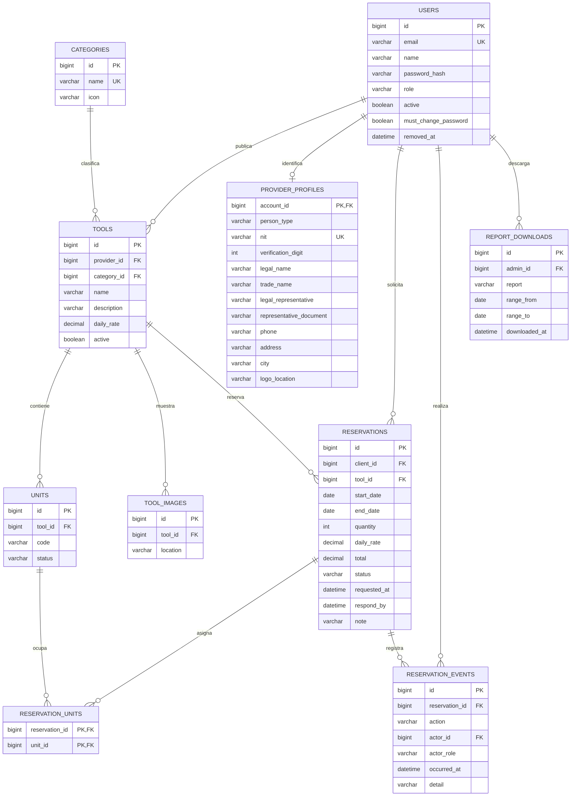

# Modelo implementado — identidad, inventario y reservas

Migraciones: `V1__identity_inventory.sql`, `V2__reservations.sql` y `V3__provider_profiles.sql`, `V4__provider_logo.sql`, `V5__reservation_events.sql` y `V6__provider_removal.sql` en `infrastructure/src/main/resources/db/migration/`.

Claves candidatas: users.id y users.email; categories.id y categories.name; tools.id; units.id y (tool_id, code); tool_images.id. Cada clave determina todos los demás atributos de su relación. Las colecciones independientes imágenes y unidades se descomponen: no existe una relación que multiplique cada imagen por cada unidad. En estas relaciones no se identifica una dependencia multivaluada no trivial con determinante que no sea superclave; así se evita la violación de 4FN derivada de dichas colecciones. Cada publicación pertenece a un proveedor y una categoría.

Tarifa DECIMAL(14,2) positiva; estado de unidades restringido por CHECK; FKs preservan referencias y unicidad evita repetir códigos por publicación. Índices cubren herramientas por proveedor/activo y categoría/activo. Roles se validan en aplicación; el dominio evita tarifas no positivas.

Perfiles de proveedor: relación 1:1 con `users` por `account_id`, separada para no dejar columnas nulas en clientes y administradores. Claves candidatas: account_id y nit. El dígito de verificación depende funcionalmente del NIT; se guarda porque es el dato que se presenta y se comprueba al escribir, y un CHECK lo limita a 0–9. La representación legal es obligatoria solo para persona jurídica, regla que valida el dominio. `must_change_password` marca la contraseña temporal asignada por el administrador.

Reservas: cada fila depende solo de su id. `daily_rate` y `total` se guardan a propósito como valores históricos pactados al solicitar, no como copia derivable de la tarifa actual. El proveedor no se duplica en la reserva: se obtiene a través de la herramienta. Las unidades asignadas son un hecho multivaluado independiente y viven en `reservation_units` con clave compuesta (reserva, unidad), en lugar de una lista dentro de una columna, para cumplir 4FN. CHECK restringen estados, cantidad (1–20), importes positivos y `end_date > start_date`. Índices cubren la búsqueda de solapamientos (herramienta, estado, fechas), las reservas por cliente, el vencimiento (estado, plazo) y las asignaciones por unidad.

Eliminación de proveedores: `users.removed_at` marca la baja definitiva en lugar de borrar la fila, porque herramientas, reservas, eventos e informes la referencian y deben seguir diciendo quién fue. Una cuenta con `removed_at` está siempre inactiva y no aparece en el listado de proveedores.

Historial: `reservation_events` es un registro de solo inserción; cada fila es un hecho (acción, autor, rol, instante) que depende solo de su id. `actor_id` es nulo únicamente cuando el rol es `SISTEMA`, regla que fija un CHECK. El estado actual sigue en `reservations.status`: el historial no lo reemplaza, lo explica. La migración reconstruye la solicitud de las reservas existentes con su `requested_at` y su cliente. `report_downloads` deja constancia de cada informe descargado, porque contienen datos personales. Índices cubren el historial por reserva y por fecha, y las reservas por fecha de solicitud.

El modelo completo propuesto en el desglose incluye además perfiles, pagos, facturas, entregas, devoluciones e incidencias. Esas tablas aún no se crean. El diagrama como imagen y los 20 registros por entidad para entrega académica se completarán con los siguientes MVP; seis publicaciones demo no satisfacen ese entregable final.
