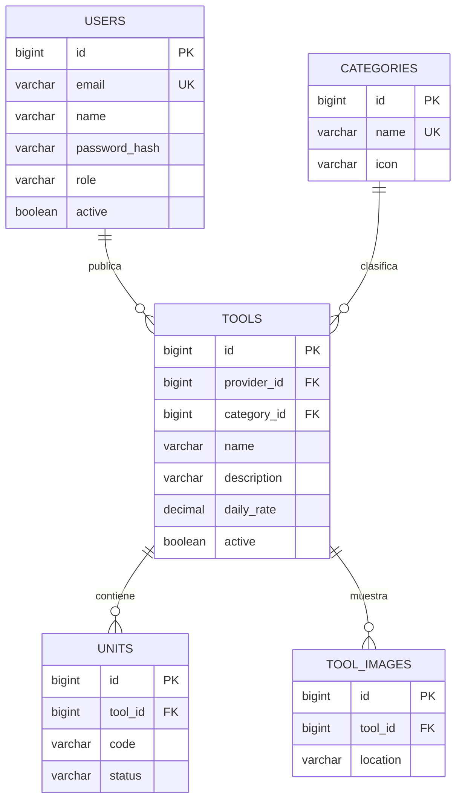

# Modelo implementado — identidad e inventario

Migración: `infrastructure/src/main/resources/db/migration/V1__identity_inventory.sql`.

Claves candidatas: users.id y users.email; categories.id y categories.name; tools.id; units.id y (tool_id, code); tool_images.id. Cada clave determina todos los demás atributos de su relación. Las colecciones independientes imágenes y unidades se descomponen: no existe una relación que multiplique cada imagen por cada unidad. En estas relaciones no se identifica una dependencia multivaluada no trivial con determinante que no sea superclave; así se evita la violación de 4FN derivada de dichas colecciones. Cada publicación pertenece a un proveedor y una categoría.

Tarifa DECIMAL(14,2) positiva; estado de unidades restringido por CHECK; FKs preservan referencias y unicidad evita repetir códigos por publicación. Índices cubren herramientas por proveedor/activo y categoría/activo. Roles se validan en aplicación; el dominio evita tarifas no positivas.

El modelo completo propuesto en el desglose incluye perfiles, reservas, pagos, facturas e incidencias. Esas tablas aún no se crean. El diagrama como imagen y los 20 registros por entidad para entrega académica se completarán con los siguientes MVP; seis publicaciones demo no satisfacen ese entregable final.
